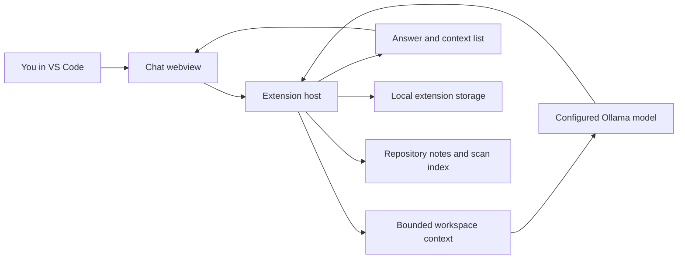

# How Jambavan works

This is a guide to the current implementation. It focuses on the path from a VS Code action to Ollama and back.

## Main parts

- **`src/chatView.ts`** builds the Activity Bar chat and handles its UI messages. The webview does not read repository files directly; it asks the extension host to do that.
- **`src/extension.ts`** registers commands, gathers context through VS Code APIs, sends chat or edit requests to Ollama, and schedules scans.
- **`src/repoKnowledge.ts`** finds eligible text files, compares hashes, requests summaries, and writes notes and the scan index.
- **`src/localMemory.ts`** stores conversation messages and user choices in VS Code extension storage.

## Chat request path

When I send a normal question, the extension collects a bounded set of context for the open workspace. Depending on the request, this can include file paths, project instruction files, a short active-file excerpt, repository notes, and excerpts from up to two files I selected. It filters some sensitive-looking filenames. The assistant reply includes a collapsible list of context items sent to Ollama.

The list is evidence of what was included in the request. It cannot prove which item the model relied on internally.

Chat messages are saved separately from repository notes. Jambavan keeps up to 40 recent conversation messages in its local VS Code storage. Feedback and remembered answers are saved as choices and can be included in later requests when their text matches the new question. This is a simple keyword match, not semantic search or model training.

## Repository scan path

1. On startup or a supported file change, the extension queues a scan for that workspace. A short delay groups nearby file changes together.
2. `repoKnowledge.ts` finds supported text files while skipping common generated and dependency directories.
3. It ignores files above the current size limit and files whose names look sensitive. It also redacts several common secret formats from the excerpt sent to Ollama.
4. It hashes file contents and skips files whose hashes have not changed.
5. For each changed file, Ollama streams back a short summary. Jambavan saves each completed summary and its hash to `.jambavan/scan-index.json` and regenerates `JAMBAVAN_NOTES.md`.
6. The VS Code progress notification has a **Cancel** action. Cancelling aborts the active Ollama request and prevents a queued automatic scan for that repository from immediately restarting. Summaries completed before cancellation remain saved.

The notes are intended as a map into the project, not as a source of truth. Verify technical claims in the original files.

## Where the data lives

| Data | Location | Purpose |
| --- | --- | --- |
| Repository summaries | `JAMBAVAN_NOTES.md` at the repository root | Human-readable project notes |
| File hashes and summaries | `.jambavan/scan-index.json` | Find changed files and resume incremental scans |
| Chat and saved choices | VS Code extension storage, keyed by workspace | Continue conversations and reuse user feedback |
| Source code and settings | This repository | Build and configure the extension |

Chat history and saved choices are not written into the repository. Repository notes are. Requests go to the Ollama URL configured in VS Code; the default is `http://localhost:11434`.

## Edit proposal path

The `/edit` chat action reads the active file and bounded guidance, then asks Ollama for a full-file replacement using a JSON schema with an `updated_file` field. This gives the extension a predictable way to separate generated code from explanation. Before opening a diff, Jambavan rejects empty or dramatically shortened proposals and checks that some substantial original lines remain. If that check rejects a response, chat asks Ollama for a focused code suggestion instead. Suggestions are displayed for review and are never applied automatically. These checks catch obvious malformed outputs, but they cannot prove that a proposal is correct. The original file is left alone until I choose **Apply proposal**. Applying writes to the editor buffer; I review and save it. Older responses using the previous `<updated_file>` tags are still accepted.

This full-file approach is currently limited to smaller files so the model can return the entire file. Jambavan does not currently run tests or commands after an edit.

## Current boundaries

- Scans happen against files visible in the local VS Code workspace. A remote GitHub PR is not observed until its changes are pulled or checked out locally.
- The context list shows what was sent, not what the model attended to.
- The secret filter is a precaution, not a guarantee. Review selected context and avoid storing credentials in source files.
- Saved user choices influence prompts as text. They do not alter Qwen's weights and should not be treated as commands.
